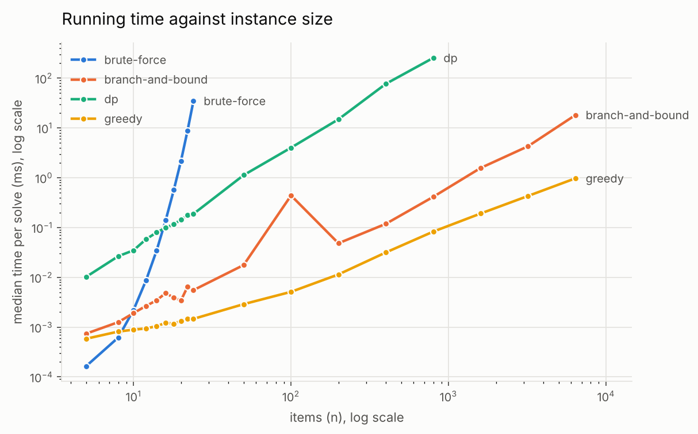
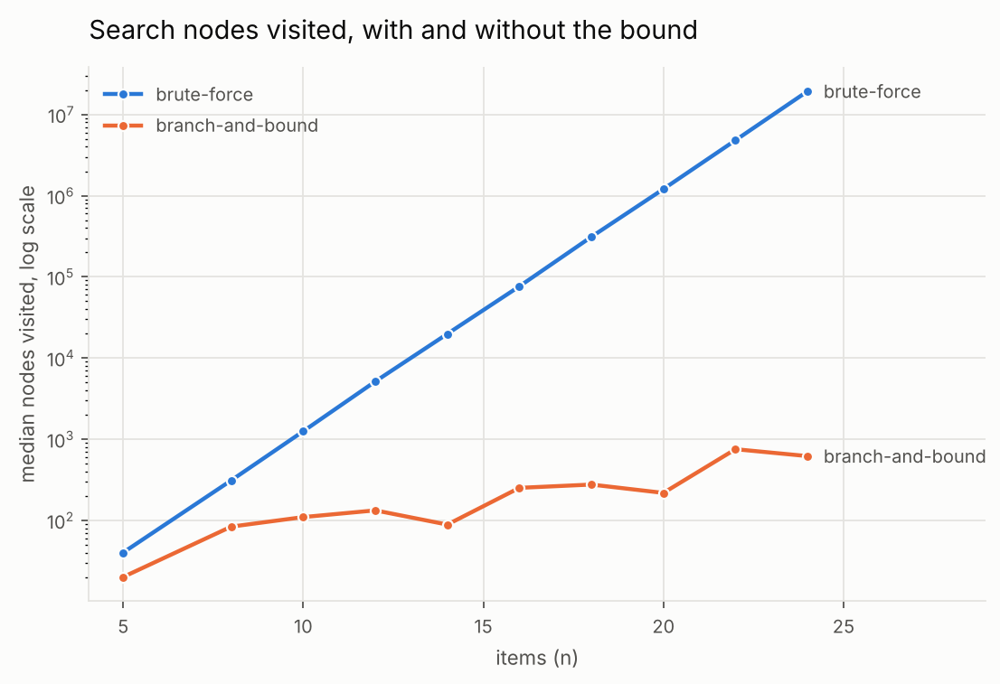
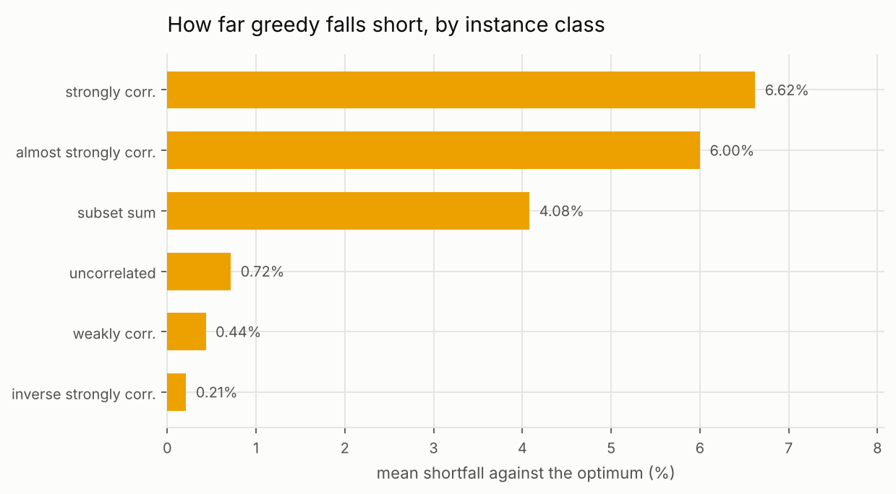
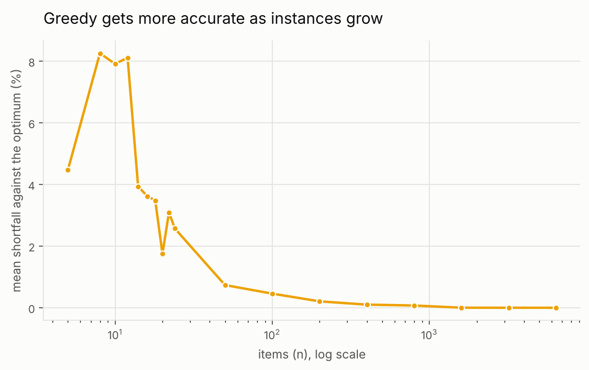

# knapsack-benchmark

Four algorithms for the **0/1 knapsack problem**, measured against each other on
generated instance families, to see where each one stops being usable and what a
fast approximation actually costs in accuracy.

## The question

Given `n` items, each with a weight and a value, and a bag that holds a limited
total weight: which items do you take to maximise value? The problem is NP-hard,
so the interesting question is not whether it can be solved but **which algorithm
to reach for, and when**.

Three answers are exact and one is a heuristic. Comparing them needs instances
that are hard in different ways, which is what the generated families provide.

## Algorithms

| Algorithm | Exact | Complexity | Idea |
|---|---|---|---|
| Brute force | yes | O(2ⁿ) | try every subset, as an include/exclude recursion |
| Branch and bound | yes | O(2ⁿ) worst case | the same search, with subtrees that cannot win cut off |
| Dynamic programming | yes | O(n·W) | best value for each prefix of items and each capacity |
| Greedy | **no** | O(n log n) | sort by value per unit of weight, take while it fits |

**Branch and bound** visits items in decreasing value-per-weight, so a good
solution is found early, and at each node bounds what is still reachable by
solving the *fractional* relaxation of the rest: whole items while they fit, then
a fraction of the next to fill the bag exactly. Allowing a fraction can only
help, so that value is never below the subtree's true optimum. When it does not
beat the best solution found so far, the subtree is skipped unvisited.

**Dynamic programming** is O(n·W), which is pseudo-polynomial rather than
polynomial: linear in the capacity's *value*, which grows exponentially in the
number of digits used to write it. Fast on many items with a small capacity,
hopeless on a capacity in the billions.

**Greedy** has no approximation guarantee at all. The ratio is a heuristic for
which items earn their space, and one pass cannot revisit a choice.

## Instance classes

Values and weights are drawn with R = 1000, and the capacity is half the total
weight. These families differ only in how an item's value relates to its weight
— which is precisely what decides whether sorting by ratio tells you anything.

| Class | Weight | Value |
|---|---|---|
| Uncorrelated | uniform in [1, R] | uniform in [1, R] |
| Weakly correlated | uniform in [1, R] | uniform in [w − R/10, w + R/10], at least 1 |
| Strongly correlated | uniform in [1, R] | w + R/10 |
| Inverse strongly correlated | v + R/10 | uniform in [1, R] |
| Almost strongly correlated | uniform in [1, R] | uniform in [w + R/10 ± R/500] |
| Subset sum | uniform in [1, R] | w |

Generation is seeded and the seed is stored next to each instance, so any
reported number can be reproduced exactly.

## How the timings were measured

A JVM does not run a method at full speed the first time: classes load, the
bytecode is interpreted, and only after enough iterations does the JIT compile it
to machine code. **Timing a single first call measures that warm-up, not the
algorithm**, and the error is not small — it easily makes a method look an order
of magnitude slower than it is, and it lands hardest on whichever solver happens
to run first.

So each measurement discards three runs to let the JIT settle, then repeats the
timed run until a 200 ms budget is spent (3 to 15 runs) and keeps the **median**,
which a stray garbage-collection pause cannot drag around the way a mean can. The
result is also touched afterwards, so the JIT cannot delete work whose output is
never read.

This is a reasonable harness, not a rigorous one. A publishable measurement would
use JMH.

## Results

Run on 60 small instances (n from 5 to 24) and 48 large ones (n from 50 to 6400),
ten sizes and eight sizes across each of the six families.

### Running time



Brute force is a straight line on a log scale, which is what an exponential looks
like: usable to about n = 20 and finished as a practical option by n = 25. The
largest n each algorithm handled within its limits:

| Algorithm | Largest n solved | What stopped it |
|---|---|---|
| Brute force | 24 | 2ⁿ, already 35 ms at n = 24 |
| Dynamic programming | 800 | the n × W table, past 200 M cells by n = 1600 |
| Branch and bound | 6400 | the node budget, on correlated families only |
| Greedy | 6400 | nothing |

Worth noting that dynamic programming is the one whose limit is *not* the number
of items. It stops because capacity grows with n in these instances, so the table
grows quadratically.

### What the bound is worth



Across the whole small set, brute force visited **154 million** nodes and branch
and bound **28.5 thousand** — a factor of 5400, for the same answers. At n = 24
that is 34.8 ms against 0.0055 ms, roughly 6300× faster.

The two differ only by the bound. Both are O(2ⁿ) in the worst case and both
return the exact optimum; what changes is how much of that worst case is ever
reached.

How much pruning helps is not constant across families:

| Class | Nodes, brute force | Nodes, branch and bound | Reduction |
|---|---|---|---|
| Uncorrelated | 26.4 M | 535 | 49 346× |
| Weakly correlated | 24.7 M | 1 522 | 16 245× |
| Inverse strongly correlated | 25.8 M | 4 070 | 6 333× |
| Strongly correlated | 26.1 M | 5 784 | 4 504× |
| Almost strongly correlated | 26.7 M | 7 199 | 3 702× |
| Subset sum | 24.5 M | 9 397 | 2 608× |

On the large instances, branch and bound hit its 50 M node budget on strongly
correlated, almost strongly correlated and inverse strongly correlated instances,
and never on the other three.

### What greedy costs



| Class | Mean shortfall | Worst case |
|---|---|---|
| Strongly correlated | 6.62% | 23.81% |
| Almost strongly correlated | 6.00% | 21.63% |
| Subset sum | 4.08% | 26.57% |
| Uncorrelated | 0.72% | 6.23% |
| Weakly correlated | 0.44% | 1.72% |
| Inverse strongly correlated | 0.21% | 2.85% |

The split is not about size, it is about **how much the ratios differ from each
other**. On uncorrelated instances, value per weight varies widely, so sorting by
it genuinely separates good items from bad. On strongly correlated ones, value is
weight plus a constant, so every ratio is nearly identical and the sort is close
to arbitrary — greedy is left choosing almost at random. Subset sum is the
extreme: value *equals* weight, every ratio is exactly 1, and the ordering
carries no information whatsoever.

The same property drives both halves of this project. Where ratios cluster,
greedy loses its criterion and the fractional bound loses its grip — the
families that cost greedy the most accuracy are broadly the ones where pruning
helps least. The ordering is not identical in the two tables, so ratio spread is
clearly not the only thing that matters, but it is the dominant effect.

### Greedy improves as instances grow



This one runs against intuition. Greedy's shortfall peaks around 8% at n ≈ 10 and
falls to effectively zero past n = 1600.

The reason is that greedy's loss comes from the capacity it leaves unused at the
end, when nothing remaining fits. That waste is bounded by the size of one item,
and with more items each one is a smaller share of the bag. The error is roughly
"one item's worth", which shrinks relative to the total as n grows.

So the practically awkward instances are the small ones — exactly the ones an
exact algorithm can handle anyway.

## Limitations

- Timing uses a hand-rolled harness, not JMH, so these numbers support
  order-of-magnitude comparisons rather than fine ones.
- One instance per (family, size) combination, so per-point noise is real; the
  trends are robust, individual points are not.
- Everything runs single-threaded on one machine, with no attempt to control CPU
  frequency scaling or other load.
- Dynamic programming keeps the whole n × W table in order to recover the chosen
  items. A rolling row would use O(W) memory and raise the size limit considerably,
  at the cost of returning only the optimal value.

## Running it

Needs JDK 17+ and Maven; the charts need Python with pandas and matplotlib.

```bash
mvn test
mvn compile

java -cp target/classes knapsack.gen.GenerateInstances              # -> data/
java -cp target/classes knapsack.bench.Benchmark data/small.csv results/small.csv
java -cp target/classes knapsack.bench.Benchmark data/large.csv results/large.csv

python3 scripts/plot.py                                             # -> results/*.png
```

## Tests

There is no table of hand-written expected answers, because that would only test
the cases someone thought to write down. Instead the solvers check each other:
three of them claim to be exact, so on every random instance all three must
agree, and brute force — simple enough to be obviously correct — is the
reference. Each solution is also re-added from its own item list and checked
against the bag's capacity, so a solver cannot report a value it did not actually
achieve or quietly overfill the bag. That comes to roughly 4400 assertions over
720 generated instances.

On top of that, edge cases every solver must handle: a bag with no capacity, an
instance with no items, an item too heavy to fit, an item that fits exactly, a
weightless item (free value, and an infinite ratio that would otherwise break the
sort), and a small instance where the ratio order is provably the wrong choice.

## Layout

```
data/        generated instances
results/     benchmark output and charts
scripts/     plotting
src/main/java/knapsack/
    solvers/ the four algorithms
    gen/     instance generation
    io/      instance reading and writing
    bench/   the timing harness
src/test/java/knapsack/
```

## References

Pisinger, D. *Where are the hard knapsack problems?* Computers & Operations
Research 32(9), 2005 — the source of the instance families used here.

## License

MIT
